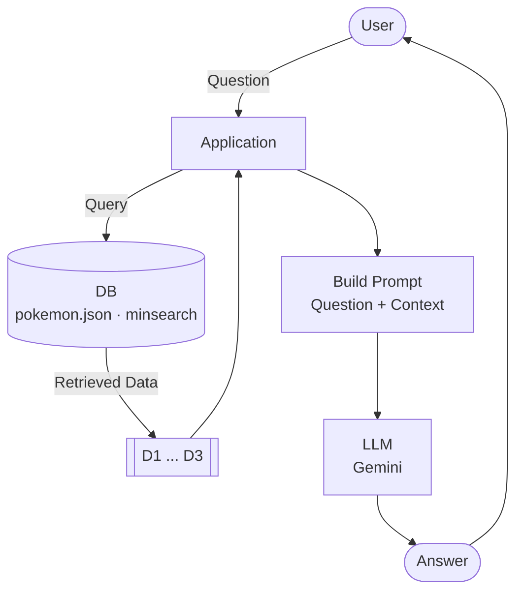

# Architecture

Current RAG pipeline: a fixed, single-search flow.

## Mapping to code

| Diagram | Code |
|---|---|
| Application | `rag()` in [main.py](main.py) |
| DB | `index` (minsearch) built from [data/pokemon.json](data/pokemon.json), produced by [ingest.py](ingest.py) |
| Query → D1 ... D3 | `search()` returns the top `NUM_RESULTS` documents |
| Build Prompt | `build_prompt()` + `build_context()` |
| LLM | `llm()` via Gemini's OpenAI-compatible endpoint |
