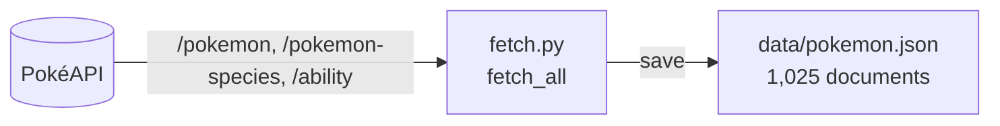
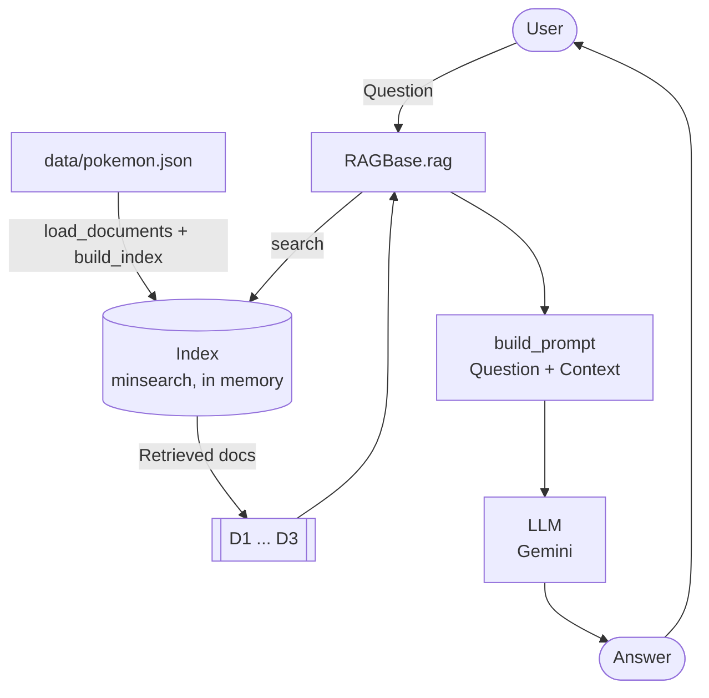

# Architecture

Two separate flows: **ingestion** gets the data, and **query** answers questions.

## Ingestion

Run rarely, by hand.



## Query

Runs on every question. The index is currently rebuilt in memory on each run.



## Mapping to code

| Diagram | Code |
|---|---|
| fetch.py | `fetch_all()` → `fetch_pokemon(i)` per Pokémon, `save()` |
| Index | `build_index()` in [ingest.py](ingest.py) (minsearch) |
| RAGBase.rag | [rag_helper.py](rag_helper.py): `search()` → `build_prompt()` → `llm()` |
| D1 ... D3 | `search()` returns the top `NUM_RESULTS` documents (default 3) |
| LLM | `llm()` via Gemini's OpenAI-compatible endpoint (`chat.completions`) |
| Wiring | [main.py](main.py) creates the client and index, then `RAGBase` |

## Document shape

```json
{
  "id": 94,
  "name": "gengar",
  "genus": "Shadow Pokémon",
  "generation": "generation-i",
  "primary_type": "ghost",
  "types": "ghost poison",
  "legendary": false,
  "abilities": "cursed-body: ...",
  "stats": "hp: 60, attack: 65, ...",
  "pokedex": "..."
}
```

Text fields (searched): `name`, `genus`, `types`, `abilities`, `pokedex`, `stats`.
Keyword fields (filters): `generation`, `primary_type`.

## Planned

- **Step 09:** ingestion also writes `data/pokemon.db` (sqlitesearch), and the query flow opens it instead of rebuilding the index.
- **Steps 13–14:** the LLM calls `search` as a tool, in a loop, until it can answer.
